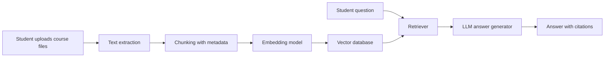

# CourseMate AI

CourseMate AI is building toward an AI study assistant with citations. The implemented V1.1 milestone is end-to-end PDF ingestion: course management, upload, text extraction, canonical chunks, bounded status polling, explicit retry, and safe shared-document deletion. Retrieval, embeddings, generated answers, and study tools remain future work.

## Why this project

This is a portfolio-oriented RAG project with a clear real-world use case. It shows practical skills in full-stack development, document processing, embeddings, vector search, LLM orchestration, evaluation, and product thinking.

## V1.1 implemented behavior

Upload a PDF (up to 10 MiB) from a course detail page. The API commits the Document and deduplicated Content before scheduling an in-process FastAPI background task. The task receives only `content_id`, opens its own database session, and parses/chunks the stored PDF. The page checks status every 3 seconds for at most 2 minutes, stops on terminal states, and shows polling errors separately from document errors.

- `uploaded`: pending an attempt; Retry can recover missed work.
- `processing`: transaction-local during new work; historical committed processing rows are not automatically reset.
- `ready`: canonical text chunks are available. Sharing this file with another course reuses them without parsing again.
- `failed`: first processing attempt failed; explicit Retry is required.
- `pending_cleanup`: no remaining course references; committed cleanup intent is retained until filesystem and metadata cleanup finish.

Delete removes only the selected course association. Other courses keep their shared Content, file and chunks. The last deletion commits `pending_cleanup` before attempting file deletion. Cleanup errors retain a retryable tombstone; run `python -m app.cleanup` from `services/api` to retry pending cleanup.

**BackgroundTasks are not a durable queue.** A restart/crash can lose pending processing or cleanup tasks. There is no automatic startup recovery. Retry an `uploaded`/`failed` document through the UI; rerun the cleanup CLI for pending tombstones. A historical `processing` row requires operator investigation, not blind automatic reset. Processing keeps its row lock and chunk replacement in one transaction, so pending status is not proof a worker is currently executing.

Database migrations must be applied before starting the new version. Revision `c3a11d0c2026` enforces one Document per `(course_id, content_id)` and refuses historical duplicates with reconciliation guidance. Default storage is `services/api/storage`; `COURSEMATE_STORAGE_DIR` can select a dedicated local directory.

See [the V1.1 engineering report](docs/V11_DOCUMENT_PROCESSING_REPORT.md) for architecture, lifecycle ordering, verified scenarios and limitations.

## Planned product features

- Upload course files: PDF slides, assignment specs, past exams, text notes, and subtitles.
- Ask course-specific questions and receive grounded answers.
- Show citations for every answer, including source file and page or section.
- Generate revision notes from selected materials.
- Generate multiple-choice and true/false questions.
- Track answer quality using a small evaluation set.

## Planned RAG scope

The first version should focus on one course and a small set of documents.

1. User uploads PDF or TXT course materials.
2. Backend extracts text and chunks it with metadata.
3. Embeddings are stored in a vector database.
4. User asks a question in the web app.
5. System retrieves relevant chunks and asks the LLM to answer with citations.
6. UI displays answer, cited sources, and retrieved snippets.

## Stack and future choices

- Implemented frontend: Next.js 16.3, React 19, TypeScript, Tailwind CSS
- Implemented backend: FastAPI, SQLAlchemy, Alembic, PostgreSQL
- Database: PostgreSQL
- Vector search: pgvector, Chroma, or Qdrant
- Implemented PDF parsing: pypdf; no OCR
- LLM: OpenAI API or another compatible model provider
- Evaluation: custom golden Q&A set plus retrieval hit-rate checks

## Two-Person Split

Person A can focus on product and frontend:

- Upload page
- Course document library
- Q&A chat interface
- Citation display
- Revision notes and quiz UI

Person B can focus on backend and AI pipeline:

- File parsing
- Chunking and metadata
- Embeddings and vector search
- RAG prompt design
- Evaluation scripts
- API design

Both people should review each other's work through pull requests.

## Milestones

### Week 1: Project Setup

- Finalize stack
- Create GitHub repository
- Set up frontend and backend skeleton
- Add basic README, roadmap, and issues

### Week 2: Upload and Parsing

- Support PDF and TXT upload
- Extract text with page metadata
- Store documents and chunks

### Week 3: Retrieval

- Generate embeddings
- Store vectors
- Retrieve top relevant chunks for a query

### Week 4: Q&A with Citations

- Build RAG answer endpoint
- Enforce citation format
- Display answer and sources in the UI

### Week 5: Study Tools

- Generate revision notes
- Generate MCQ and true/false questions
- Save generated study sets

### Week 6: Evaluation and Demo

- Create a small benchmark dataset
- Measure retrieval quality and answer faithfulness
- Record demo video
- Polish README with screenshots and architecture diagram

## Evaluation Ideas

- Retrieval hit rate: whether the correct document chunk appears in top-k results.
- Citation accuracy: whether cited snippets actually support the answer.
- Answer faithfulness: whether the model avoids unsupported claims.
- Latency: upload processing time and average Q&A response time.

## Planned RAG architecture



## Repository Structure

```text
coursemate-ai/
  apps/
    web/
  services/
    api/
  docs/
  evals/
  README.md
```

## Local Development

Prerequisites: Node.js 20.9 or newer, Python 3.11 or newer, and Docker Desktop
(or another Docker installation with Compose). Clone the repository, then run
the backend and frontend in separate terminals.

### 1. Backend and database

From the repository root:

```bash
cd services/api
cp .env.example .env
docker compose up -d postgres
python -m venv .venv
source .venv/bin/activate
pip install -r requirements.txt
alembic upgrade head
uvicorn app.main:app --reload --port 8000
```

Windows PowerShell uses these two equivalent commands in place of `cp` and
`source`:

```powershell
Copy-Item .env.example .env
.\.venv\Scripts\Activate.ps1
```

Confirm the API is running at <http://localhost:8000/health>. Swagger is at
<http://localhost:8000/docs>.

### 2. Frontend

```bash
cd apps/web
npm ci
npm run dev
```

Open <http://localhost:3000>. The frontend uses `http://localhost:8000` by
default. If the API runs elsewhere, create `apps/web/.env.local`:

```env
NEXT_PUBLIC_API_URL=http://localhost:8000
```

The V1.1 interface can create, list, open, and delete courses. Course detail
accepts PDF uploads, automatically observes processing, and provides Retry and
confirmed document deletion. API errors such as invalid PDFs, missing courses,
duplicate documents, and oversized files are shown in the page.

## Verification

From `services/api`, install `requirements-dev.txt` and run `python -m pytest -q`.
Set `TEST_POSTGRES_URL` to a disposable PostgreSQL database to enable isolated-schema locking, lifecycle and migration checks. These tests do not use the application's `DATABASE_URL` or developer tables. From `apps/web`, run `npm run lint`, `npm test`, and `npm run build` (Node 22.14+ for the dependency-free TypeScript polling tests).

## Future resume talking points (after implementation)

- Built an end-to-end Retrieval-Augmented Generation application for course-specific study assistance.
- Implemented document parsing, chunking, embeddings, vector retrieval, and citation-grounded answer generation.
- Designed evaluation metrics for retrieval quality and answer faithfulness.
- Collaborated through GitHub issues, pull requests, and milestone planning.
