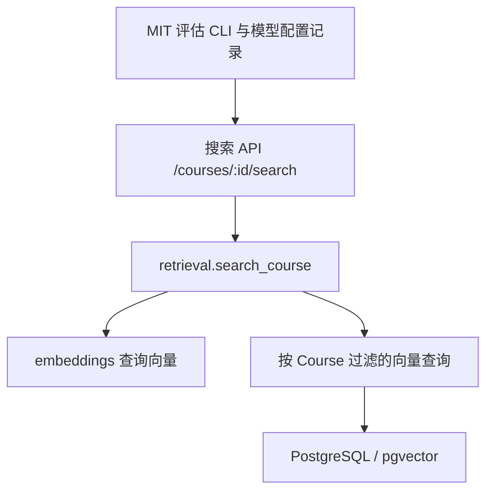

# 当前检索版本确认

核对日期：2026-10-30，Australia/Adelaide。分支：`codex/rag-testing-without-api`。

## 版本关系

本次提交直接基于组员测试后的 `0112c82c7d6ee3df0f5c98767ae9e9fdec0d7323`，
其提交说明为 `test: complete retrieval browser interaction QA`。
推送前核对 GitHub，同名远端分支也停在该提交，因此没有遗漏组员在此分支上的后续提交。
本次提交包含之后的本地补充，不能把所有新增内容都归为组员已经测试过。

| 范围 | 本次确认 |
| --- | --- |
| 组员完成的版本 | MIT 6.006 五份 PDF、25 题评估、本地 BGE 实测、检索调试页面和浏览器交互 QA |
| 本次补充 | 完整排名 MRR 计算及完整性检查、显式模型配置记录、回归测试、独立 PostgreSQL 测试环境及日志 |
| 独立实验 | 保存 Codex 生成的 3 张知识卡片和 1 条问答及其原始记录；尚未接入应用 |
| `main` | 核对时仍为 `4d03922`；本次不合并 |
| 另一条开发分支 | `feature/v1.1-document-processing` 为 `d4b2f9e`，不包含在当前检索分支；其处理流程须另行审查整合 |

## 验证证据与质量边界

本次推送前重新运行完整后端套件，连接独立测试 PostgreSQL/pgvector：
**224 passed、2 skipped、1 warning，耗时 9.09 秒，退出码 0**。
两项跳过均为真实 embedding 模型测试；测试子进程将 `OPENAI_API_KEY` 置空且
`RUN_LIVE_EMBEDDING_EVAL=0`。已有 Starlette/AnyIO 弃用警告原样保留。
原始记录见 [本次完整日志](test-runs/2026-10-30-pre-push/README.md)。

- [之前要求补跑的 59 项 PostgreSQL 测试](test-runs/2026-10-29-postgres59/README.md)：59 通过，0 跳过，保存逐项说明及环境。
- [MRR 与模型记录设计、自审](RETRIEVAL_STATUS_2026-10-28.md)：完整 MRR 的代码已实现，尚无新的真实模型完整 MRR 实测值。
- [组员真实课程评估](REAL_COURSE_RETRIEVAL.md)：历史本地 BGE 页命中率 Top 1/3/5 为 68%/88%/96%，锚点 MRR@5 为 0.6933；不代表生产 OpenAI 模型结果。
- [Codex 生成实验](../evals/knowledge/codex-smoke/2026-10-29/README.md)：一次真实生成，4 条来源锚点可定位；不证明知识覆盖率或检索质量。

历史文件中的“仅本地、未推送”和旧测试数量描述对应各自日期；当前交付范围以本文件及 Git 提交为准。
[10 月 11 日工程总结](ENGINEERING_SUMMARY_RETRIEVAL_ZH.md) 保留为历史设计记录。

## 本次代码边界自审

本次没有改动生产 provider、检索 SQL、回填、PDF parser、模型或迁移。
模型记录校验集中在一个小模块，由评估入口和本地运行脚本复用；没有增加 factory、manager、repository 或插件框架。
评估编排负责核对来源和完整结果集合，不能借 Top 5 输出冒充完整排名。
记录声明不等于服务端模型证明，未知上游版本保持 null。

没有新增数据库 Session 或事务，也没有新增 Chunk/embedding 写入位置；生产写入仍由 parser 和 backfill 管理。
新增写入仅为评估和实验文件。评估 `run` 约 70 行，职责为单轮测量编排；
模型记录校验独立且不导入 API、数据库或 PDF 解析。旧 bounded 评估仍被兼容调用和测试使用，未加入仅为未来用途保留的抽象。
知识生成脚本仅作为实验复现记录，不参与生产请求流程。

当前可作为检索工程基线继续开发；生产模型的真实质量评估、完整 MRR 测量仍待执行。
离线知识库数据库和界面、自动处理工作流、RAG 生成均不在本次提交中实现。
