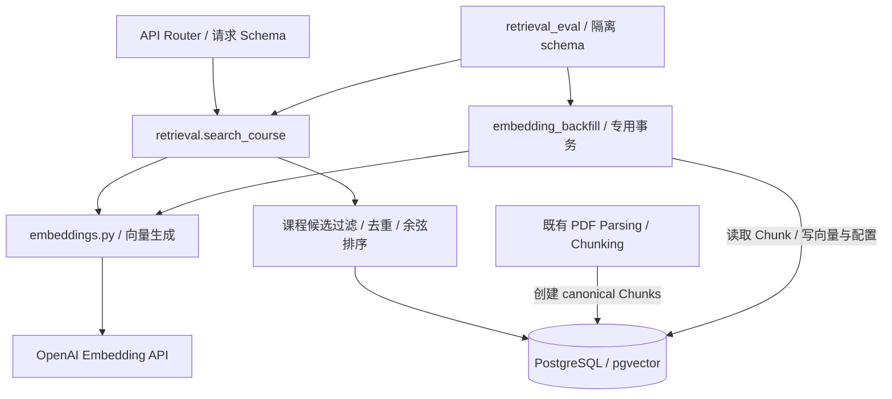

# CourseMate-AI 检索工程总结与设计自审

日期：2026-10-11，Australia/Adelaide。

**当前完成了可测试、可重试、按课程隔离的检索基础，以及真实模型评估工具。工程回归通过；真实 embedding 的检索质量尚未验证。**

## 1. 代码状态与本次总结范围

| 项目 | 当前状态 |
| --- | --- |
| 当前分支 | `codex/rag-testing-without-api`，已推送并跟踪同名远端分支 |
| 代码快照 | `eaccba0a1d83b2817e5b5d3cdefbafd0a6d6ce4c` |
| 原始基线 | ver2：`259609e41da4da7b5d6b9ba0effb22a3ca20c996` |
| 检索基础完成点 | `813e4ea`，包含独立审查后的修正 |
| 评估工具完成点 | `eaccba0`；这一阶段没有调整生产检索算法 |
| 合并状态 | 未合并到 `main` |

本总结覆盖检索基础和后续检索评估两个阶段。相对原始基线，代码快照共修改 **31 个文件，增加 3341 行、删除 30 行**，包括设计文档、数据集和测试；这不是纯生产代码行数。本总结文件不计入该快照。

早期报告记录的是当时的分支及推送状态；当前状态以本节为准。

## 2. 已实现的功能及对应代码

| 功能 | 实现内容 | 主要代码 |
| --- | --- | --- |
| 向量存储 | 原有 Chunk 增加 nullable 向量及配置标识，数据库约束要求两者同时有值或同时为空 | `services/api/app/models/chunk.py`；迁移 `c81d4a6b209f_chunk_embeddings.py` |
| Embedding 生成 | 单一 provider 模块负责调用、配置身份、维度及数值校验、安全错误 | `services/api/app/embeddings.py` |
| 可重试回填 | 对 ready Content 的既有 Chunks 生成向量；默认跳过有效同配置向量；支持指定 Content、强制刷新 | `services/api/app/embedding_backfill.py` |
| 课程内检索 | 查询 embedding、课程候选过滤、共享内容去重、精确余弦排序、稳定 top-k | `services/api/app/retrieval.py` |
| HTTP 接口 | `POST /courses/{course_id}/search`，输入验证、响应序列化、404/422/503 转换 | `services/api/app/routers/courses.py`；`app/schemas/retrieval.py` |
| 课程评估 | 25 题、Top 1/3/5、完整 MRR、延迟、实际检索段落和运行元数据 | `services/api/app/retrieval_eval.py`；`evals/retrieval/` |
| 回归验证 | 单元、API、真实 PostgreSQL/pgvector、迁移、事务与并发测试 | `services/api/tests/test_*retrieval*`、`test_embeddings.py`、`test_embedding_backfill.py` |

保留原有 `Course → Document → Content → Chunk` 数据关系。同一文件的 Content/Chunks 可以被多个课程的 Document 引用，向量按 canonical Chunk 保存，不按 Document 重复生成。

PDF 上传、哈希去重、提取、分块和原子处理逻辑沿用既有实现。上传后尚无自动解析或 embedding 调度；当前通过独立处理入口和 backfill CLI 执行。没有新增 RAG 生成、聊天、生成式引用、reranker、hybrid search 或后台队列。

## 3. 模块边界与关键实现

### 3.1 内部接口

当前应用内检索入口只有一个明确的函数契约：

```python
def search_course(
    db: Session, course_id: int, query: str, top_k: int,
) -> list[RetrievalResult]:
    ...
```

`RetrievalResult` 是不可变 dataclass，包含 `chunk_id`、`text`、`page_number`、`document_id`、`document_name`、`score`。API 和未来生成层不必了解 pgvector SQL。显式传入 Session 是为了明确资源所有权，没有增加依赖注入框架或通用 repository。

| 模块 | 负责 | 边界约束 |
| --- | --- | --- |
| Router / schema | 请求、默认参数、序列化、HTTP 错误 | 不实现模型调用、向量 SQL、PDF 处理 |
| `retrieval.py` | 检索编排、候选范围、去重和排序 | 消费既有 Chunk，不负责创建 Chunk 或生成回答 |
| `embeddings.py` | provider HTTP、配置身份、向量校验 | 不导入 SQLAlchemy 模型、router、parser 或 chunker |
| `embedding_backfill.py` | 对既有 Chunk 回填向量及事务协调 | 不解析 PDF，不改变 Chunk 文本、页号或切分 |
| `parsing.py` | 原有提取、清洗、分块及 Content 处理 | 不依赖 Retrieval 或 RAG |
| `retrieval_eval.py` | 夹具、评估、证据记录、临时数据库资源 | 复用 backfill/search，不复制检索算法 |

### 3.2 配置身份与兼容性

实际代码用一个配置标识记录向量空间：

```python
@property
def identifier(self) -> str:
    return f"openai:{self.model}:{EMBEDDING_DIMENSIONS}:{self.revision}"
```

例如：`openai:text-embedding-3-small:1536:v1`。

每个向量同时保存此标识，检索只接受当前配置的向量。换模型或 revision 后，旧向量不会与新查询向量混排；再次运行回填即可更新。维度变化还需要数据库迁移。

这是当前需求下的小设计：每个 Chunk 一份向量、一个配置字符串，没有建立多模型注册表或多套向量索引。代价是不能同时保留多版本向量做无停顿切换；切换配置后，尚未重新生成的 Content 会暂时被排除。模型别名也不是不可变快照，provider 在同一名称下发生不兼容变化时，仍需维护者主动提升 revision。

### 3.3 课程过滤、去重和分数

候选查询先按 `Document.course_id` 限定范围，再按 Content 选择**当前课程内最小 Document ID** 作为代表。这样，同课程重复 Document 不会重复返回同一 canonical Chunk；不同课程共享 Content 时，各自使用本课程的文档名称和 ID。

候选还必须满足 Content ready、向量非空、配置匹配、非零向量。排序核心为：

```python
distance = func.l2_normalize(
    Chunk.embedding, type_=Vector(embeddings.EMBEDDING_DIMENSIONS),
).cosine_distance(vector)

statement = (
    candidates.add_columns((1.0 - distance).label("score"))
    .order_by(distance.asc(), Chunk.id.asc()).limit(top_k)
)
```

距离越小越相似，返回 `score = 1 - cosine_distance`，分数越大越相似。数学上的余弦相似度范围为 −1 到 1，实际存在浮点误差；它不是概率，也没有经过相关性阈值校准。同分时按 Chunk ID 排序，以保证结果确定。

当前为精确排序，没有 ANN 索引或最低分阈值。这样先验证课程范围、去重和排序正确性，避免引入另一层近似检索变量；大规模性能仍需单独测量。课程范围过滤也不等于用户身份鉴权，访问控制未包含在本里程碑内。

## 4. 参数设计、理由和限制

以下区分本次设计与继承参数。**这些值是工程起点，不是通过真实检索评估选出的最优值。**

| 参数 | 当前值 / 来源 | 设计理由 | 代价或尚未验证的部分 |
| --- | --- | --- | --- |
| Embedding 模型 | `EMBEDDING_MODEL=text-embedding-3-small`；本次默认选择 | 先建立一种明确模型配置的基础路径，避免多模型调度 | 未做模型质量、价格或延迟对比，不能声称优于其他模型 |
| 支持模型 | small / large 两个显式名称，均请求 1536 维 | 对当前受支持配置及固定维度快速校验；同维度不同模型仍以配置身份隔离 | 换 provider 要修改 provider 模块；不承诺任意模型直接可用 |
| 向量维度 | **1536**；请求参数和 `vector(1536)` 一致 | 固定存储契约，维度错误尽早失败 | 换维度需迁移、重嵌入；不是一项自由运行时参数 |
| 配置 revision | `EMBEDDING_REVISION=v1` | 为不兼容变化提供人工可控版本标记 | 不自动检测 provider 别名漂移 |
| revision 格式 | 1–64 字符，仅字母、数字、`_ . -` | 保持标识清楚、可校验 | 不接受任意描述性文本 |
| 配置字段 | `varchar(255)`，与向量配对约束 | 保存可读来源身份，避免有向量无配置的半状态 | 不保存完整 provider 响应或不可变模型制品 |
| HTTP timeout | `30.0` 秒 | 避免 provider 连接或读写长期无响应 | 是 httpx 传输阶段的超时设置，不保证整个任务在 30 秒结束；无自动 retry/backoff |
| 向量数值策略 | 有限、1536 维、float32 可表示、非零；稳定范数归一化 | 对齐 pgvector 存储，防止 NaN/Inf、上下溢和无定义余弦 | provider 和边界处重复调用同一校验函数，有少量计算开销 |
| Chunk 目标长度 | **1200 字符**；继承原实现 | 本里程碑保留已工作的入库规则与页号语义 | 是字符而非 token；目标长度不是硬上限；没有质量调优 |
| Chunk overlap | **200 字符**；继承原实现 | 保留相邻窗口的部分上下文，约为目标长度的 16.7% | 增加重复文本与向量工作量，尚未证明足以处理概念跨块 |
| 切分边界窗口 | **±200 字符**；继承原实现 | 在目标附近优先段落、换行、空格边界，减少机械截断 | 非语义切分；页内切分无法保留跨页上下文 |
| 页 / Chunk 序号 | 页号从 1 起，Chunk index 在 Content 内连续 | 可以定位来源，保持既有唯一约束 | 当前测试语料使用逻辑页，不代表 PDF 提取质量 |
| API 默认 top-k | `RETRIEVAL_DEFAULT_TOP_K=5` | 初始返回量易于人工检查，也与 Top 5 评估口径对应 | 未由实际召回/生成上下文预算选优 |
| top-k 范围 | 严格整数 **1–50** | 限制一次返回量和请求输入；拒绝布尔、字符串等隐式转换 | 不是数据库扫描量上限，也不保证查询耗时 |
| query 长度 | 去两端空白后 **1–2000 字符** | 明确请求边界并拒绝空查询、过大输入 | 不是模型 token 预算；字符与 token 不等价 |
| 候选状态 | ready + 当前配置 + 有效非零向量 | 排除处理中及不兼容向量 | 配置切换、未回填时可能合法返回空列表 |
| 重复文档代表 | 当前课程内最小 Document ID | 确定性去重且避免借用其他课程的文档元数据 | 不根据文件名或更新时间选择代表 |
| backfill 默认行为 | 有效同配置跳过；`--force` 强制重算 | 重跑可以恢复失败项，避免无必要的 provider 请求 | 没有后台自动重试；需要操作方再次执行 |
| backfill 事务粒度 | 每 Content 一次提交，串行逐 Chunk 请求 | 同一 Content 全部成功后一起切换，复用共享内容 | 大 Content 耗时较长，网络调用期间持有 Content 锁 |
| 评估规模 | 4 份讲义、12 页、24 Chunks、25 题 | 满足小型、可人工审阅的主题内评估，覆盖五种问法 | 作者编写夹具，有共同作者偏差；不能推广至所有课程 |
| 评估 top-k | **24**，一次取得全部课程排序 | 同一真实查询向量产生 Top 1/3/5 前缀，并计算未截断 MRR | 评估语料需 6–50 Chunks；延迟不等于 API 默认 k=5 |

默认 top-k 只在客户端省略该字段时读取服务端环境配置。错误的服务端默认值返回 503，客户端非法 top-k 返回 422；显式合法值不被无关的错误默认配置阻断。缺失课程返回 404；没有 eligible Chunks 的课程返回空结果，不调用 provider。

## 5. 事务、Session 与状态修改位置

| 操作 | Session / 事务所有者 | 修改位置 |
| --- | --- | --- |
| API 请求 | 原有 `get_db()` 创建并关闭请求 Session | search 路由没有新增数据库写入 |
| `search_course` | 调用方持有 Session；检索不 commit、rollback 或 close，使用 `no_autoflush` | 不修改 Chunk、Content 或向量；SQL 归一化也是只读表达式 |
| `embed_content` | 专用干净 Session；函数拥有每 Content 的 commit/rollback | `embedding_backfill.py:57–59` 写 `chunk.embedding` 与 `chunk.embedding_config` |
| PDF 处理 | 原有 `process_content` 事务 / savepoint 逻辑 | `parsing.py:167–169` 替换 Chunk 并标 ready；其他分支管理 processing / failed 状态 |
| 课程评估 | CLI 管理隔离 schema、Engine、Session 生命周期；回填事务仍交给 `embed_content` | `_seed_benchmark` 创建测试 Course/Document/Content/Chunk；legacy seed 同理 |
| 数据迁移 | Alembic | 添加扩展、列和配对约束；不调用 embedding API |

backfill 用 Content 的 no-op UPDATE 获取与 PDF processor 一致的写锁，随后重新读取状态和 Chunk。所有新向量先保存在本地列表，全部生成成功才赋值并提交；provider、验证、flush 或 commit 失败都回滚，不做失败后删除 Chunk 的补偿操作。此前已经成功提交的其他 Content 保留。

成功重新解析 PDF 会替换 Chunk，新 Chunk 需要重新回填；失败刷新保留原有 ready 数据。回填只写向量字段，不同时重建文本。

专用 Session 是明确的调用契约。函数拒绝 ORM pending changes 和调用方 nested transaction，但无法识别调用方已经 flush 的所有无关业务写入，因此未来后台调用应传 Content ID 并创建新的 Session。持锁期间调用网络是当前原子性方案的代价，尚无批处理、任务租约或断点续算机制。

## 6. 可维护性自审

| 检查项 | 结论、处理与保留理由 |
| --- | --- |
| 重复逻辑 | 查询输入规范化共用一个函数；向量校验共用一个函数。provider 与调用边界再次校验属于防御性验证，没有分叉算法。parser/backfill 的 Content 锁及 Session 检查有相似部分，为保留既有入库语义，未抽象成通用事务框架。1536 在模型和历史迁移中重复是显式 schema 契约，迁移不导入可变化运行配置。 |
| 不必要抽象 | 没有新增 factory、strategy 层级、manager、通用 repository、插件系统或单实现 ABC。两个 frozen dataclass 分别表达配置身份与结果契约。安全异常用于实际错误边界。 |
| 隐藏耦合 | provider 不依赖 API/DB/PDF。检索对固定维度、配置身份、ready 状态及 canonical Content 的依赖已显式记录。环境配置读取仍是实际运行依赖；每次操作固定配置，评估逐题检查配置漂移。 |
| 过大函数 | 检索入口 16 行，向量查询 13 行；provider 请求函数 21 行；`embed_content` 46 行。评估模块共 305 行，最长函数为保留的三主题评估 42 行，课程评估编排 22 行。未发现需要为压缩行数而拆散事务步骤的函数。 |
| 模块职责不清 | API、provider、回填、检索、评估、原有 parser 各有当前职责。课程评估复用 chunker，但 parser 不反向依赖评估或检索。评估数据库 context manager 同时服务两个实际入口，负责真实的资源生命周期。 |
| 事务 / Session 所有权 | 检索只读借用；回填独占并提交/回滚；入口创建/关闭 Session；评估入口负责 schema 清理。已测试拒绝脏 Session、回滚失败、并发互斥；已 flush 的无关写入仍依赖调用约定。 |
| Chunk / embedding 修改位置 | 生产写入集中在原 parser 的 Chunk 替换与 backfill 的两个向量字段；评估种子和测试夹具是隔离测试写入。检索没有隐式修复或状态更新。 |
| 死代码 | 原三主题评估仍由默认 CLI 和回归测试使用，属于保留兼容入口；课程评估由 `--benchmark` 使用。未发现新增未使用的 provider、alternate pipeline 或仅声明未调用的框架。 |
| 仅为假想未来添加的抽象 | 未添加。配置身份解决当前混用向量问题；结果契约解决当前 API/检索边界；context manager 解决两个当前入口的清理重复。未来扩展仅说明接入点，没有预建 reranker、hybrid 或生成器接口层。 |

已有独立审查发现并修复的具体问题：

| 阶段 | 问题 | 修正及证据 |
| --- | --- | --- |
| 检索基础 | 极大 / 极小 float32 向量可能产生 NaN 或错误余弦分数 | 新向量稳定归一化，已有向量查询时 SQL 归一化；回归验证有限 JSON 分数、排序及存储不变 |
| 检索基础 | 服务端错误默认 top-k 与客户端输入错误混淆 | 分离配置异常与请求校验，回归覆盖 503/422 和显式参数 |
| 原三主题评估 | 同分结果可能因 ID 顺序被误认为语义成功 | 要求期望主题分数严格高于无关主题，覆盖同分负例 |
| 课程评估 | H02 / H03 各遗漏一个能回答问题的证据段落 | 在真实模型测量前补充预审等价证据、升为 v2；先复现 3 个失败，再验证正确证据与无关段落的边界 |
| 课程评估 | 等价证据字段错误类型可能被按字符处理 | 增加列表 / 非空字符串检查，先复现失败后修正 |

这些修正没有根据真实模型排名修改标签、放宽分数阈值或重写分块。独立审查提出的问题已处理；本次自审未发现需要再加入架构层的理由。

## 7. 测试项目与最新结果

本次总结重新执行了完整套件，代码仍为 `eaccba0`。使用工作树 `.venv` 的 Python 3.12.14，并新建独立 disposable PostgreSQL 容器，实际版本 **PostgreSQL 17.11 / pgvector 0.8.7**。测试数据使用随机 schema；没有对用户现有 PostgreSQL 实例执行测试。

| 检查 | 本次结果 | 说明 |
| --- | --- | --- |
| 默认完整后端：`python -m pytest -q` | **116 passed, 61 skipped, 1 warning**；1.00 秒；退出 0 | 未提供 PostgreSQL 测试 URL，相关项及 live 项跳过 |
| 提供 `TEST_POSTGRES_URL` 的完整后端 | **175 passed, 2 skipped, 1 warning**；16.66 秒；退出 0 | 实际 PostgreSQL/pgvector 集成、迁移和并发用例通过 |
| 既有检索 SQL + 迁移回归 | 23 项，包含在上述完整 PG 运行中 | 没有因新评估工具移除或跳过这些回归 |
| 课程评估测试文件 | 20 项参数展开用例；其中 1 项 live 跳过，其余通过 | 标签、指标、实际 PG 排序、证据输出、清理与错误路径 |
| 真实模型 benchmark 命令 | **blocked，退出 2** | 本次再次确认无 `OPENAI_API_KEY`，未发出模型请求 |

默认和 PG 两次运行各只有一个已有的 Starlette / AnyIO BlockingPortal 弃用警告。PG 完整运行跳过的两项分别是旧三主题 live embedding 评估与新课程 live benchmark，不是检索 SQL 或迁移测试失败。

| 测试文件 / 范围 | 已验证的行为 |
| --- | --- |
| `test_embeddings.py` | 请求模型/维度/超时、配置 revision、空输入、错误维度、NaN/Inf、零向量、float32 极值、错误不泄漏 provider 内容或密钥 |
| `test_embedding_backfill.py` | SQLite 与 PG 持久化、同配置跳过、强制更新、版本切换、ready 检查、provider/flush/commit 失败回滚、脏 Session 拒绝、CLI |
| `test_retrieval_postgres.py` | 真正 vector 类型与维度约束、跨课程更相似内容排除、共享内容、重复 Document 去重、当前课程元数据、top-k、同分顺序、配置过滤、只读状态、与 PDF 刷新/回填的锁竞争 |
| `test_retrieval_api.py` | 200 空结果、404、422、503、参数默认值、输入 trim、实际 PG 检索成功、有限分数 JSON、已有向量不被修改 |
| `test_retrieval_migrations.py` | 从旧 migration head 升级并保留旧文本/页号/索引/链接，扩展及 vector(1536)，单 head、Alembic check、降级后重新升级 |
| `test_retrieval_eval.py` | 旧三主题几何控制、同分不能证明语义成功、独立 schema 成功/失败清理、live 显式启用 |
| `test_course_retrieval_eval.py` | 标签定位与错误拒绝、指标完整分母、第 6 名仍影响 MRR、Top 5 全文和 expected hit 全文、缺 key / URL / 配置、真实 PG 排序、异常清理、等价证据与负例 |
| 原有后端测试 | 课程、上传、存储、PDF/分块和既有 PostgreSQL 处理并发回归继续通过 |

**测试边界：** provider 在单元/集成测试中使用受控 HTTP 或向量替身；SQL 排序、约束、迁移、事务与锁在真实 PostgreSQL 上运行。因此上述通过证明工程行为，不证明真实模型能理解课程问题。

## 8. 检索评估：已具备什么、还缺什么

数据集为编写的“并行计算基础”测试课程，包含性能与 Amdahl、共享内存、MPI、任务分解四份讲义。25 题中，直接事实、改写、术语、概念比较、较难语义问题各 5 题。问题带预先指定的文档、页、主题与证据段落；不是直接复制来源完整句子。

其来源是工程夹具，不是真实大学课件或独立学生问题。实际生成 24 个 Chunks，长度 458–1197 字符。评估使用已提取的页文本，不验证 PDF 提取、OCR 或图片理解。

| 指标 | 定义 | 真实模型结果 |
| --- | --- | --- |
| Recall@1 / @3 / @5 | 前 K 条至少命中一个预审证据 Chunk 的问题数 / 25 | 未测量，均为 `null` |
| MRR | 全部 25 题的首个相关排名倒数平均；无命中为 0；使用完整排序 | 未测量，为 `null` |
| mean / median / p95 延迟 | 一次 search 的查询 embedding 网络调用与 SQL；不含 seed、回填、HTTP router | 未测量，为 `null` |

每题只有一个黄金来源证据单元，同页主证据和预审等价证据是可接受替代，重叠 Chunk 不增加分母。因此这里 Recall@K 等价于该定义下的 source Hit Rate@K，不能解释成“召回全部潜在相关段落的比例”。p95 使用 nearest-rank，即排序后第 `ceil(0.95 × N)` 个值。

工具会记录数据集 ID / SHA-256、配置身份、chunk manifest、每题实际 Top 5 的完整文本 / 分数 / 页与文档、全部排名 ID，以及黄金段落的实际排名和全文。可以检查第 5 名之后的正确段落，避免只看汇总指标。

当前数据集为 `parallel-computing-v2`，SHA-256：

```text
c7d55c6273de37b6f0d272d1a0d15752c10b8d11b9c8a3dc1113fd3b9491f3a0
```

本次再次运行得到 `status=blocked`、`real_embeddings_used=false`、`results=[]`，退出码 2。此前 v1、v2 的 blocked JSON 记录均已保留。没有真实成功/失败案例可以展示，也没有真实失败原因或调优收益可以归因。

后续失败审查需结合实际文本判断：chunk 边界、问法/术语差异、embedding 相似度、重复/共享 Content、分数方向、top-k、课程过滤或标签遗漏。当前仅标签遗漏有已确认的评审证据；不能据缺少 API key 断言模型相似度差。

**建议：先完成真实 embedding 评估，再决定是否需要小幅检索调优，暂缓进入 RAG generation。** 本阶段没有对生产检索做调优，也不存在真实质量 before/after 数据。测量成功退出 0 只表示评估完成，不代表达到某个已设定的质量验收线。

## 9. 未来扩展边界与保留限制

| 未来变化 | 现有接入点 | 仍需做的实际工作 |
| --- | --- | --- |
| 换 embedding 模型 / provider | `embeddings.py`、配置身份、backfill | 更新真实 provider 实现；不兼容时提升配置身份并重嵌入；换维度另做迁移 |
| reranker | 检索候选及结果契约 | 以后根据实测需要扩充检索编排；当前没有空的策略接口 |
| hybrid lexical + vector | `retrieval.py` 的候选/排名职责 | 增加词法查询及融合；无需修改 PDF 提取和分块模块 |
| RAG generation | 调用 `search_course` 获取文本与来源元数据 | 新增生成层、提示和验证；依赖方向为生成 → 检索 |
| 后台执行系统 | 以 Content ID 调用 `embed_content` | worker 自建 Session，设计任务重试/并发；不把请求 Session 传给后台 |

当前主要限制是：真实模型质量未知、精确扫描的大规模耗时未知、持锁串行网络回填、配置切换期间旧向量被排除、字符分块缺乏 token/语义预算、没有自动调度与鉴权。它们是明确的后续工程或评估边界，不作为添加假想框架的理由。

## 10. 已实现的依赖流程



图中数据库是共享的数据边界；parser 不调用 retrieval，provider 不导入模型。检索的 SQL 细节停留在 `retrieval.py`，API 和后续生成层只使用检索契约。

## 11. 复现入口与详细材料

以下从工作树的 `services/api` 运行。密钥通过环境或本地 `.env` 配置，不写入仓库。

```bash
# 生成已有 ready Content 的向量
../../.venv/bin/python -m app.embedding_backfill --content-id 123

# 默认后端测试；启用 PG 时另提供专用 TEST_POSTGRES_URL
../../.venv/bin/python -m pytest -q

# 真实模型课程评估：需 OPENAI_API_KEY 与专用 TEST_POSTGRES_URL
../../.venv/bin/python -m app.retrieval_eval --benchmark \
  --output ../../evals/retrieval/results/parallel-computing-v2-live.json
```

真实评估会在提供的测试数据库内创建并清理临时 schema；配置 key 后将实际调用 provider。

相关材料：

- [检索基础修改报告](RAG_RETRIEVAL_FOUNDATION.md)
- [检索评估报告](RETRIEVAL_EVALUATION.md)
- [人工题目表、指标与失败检查](../evals/retrieval/README.md)
- [课程数据及 25 题](../evals/retrieval/parallel_computing.json)
- [v2 blocked 运行记录](../evals/retrieval/results/parallel-computing-v2-blocked-2026-10-11.json)

本次总结仅新增本文档，未修改生产代码、参数、数据集或历史运行记录；本文档当前保存于本地工作树，尚未提交或推送。上述“已推送”指代码快照 `eaccba0` 所在分支。
