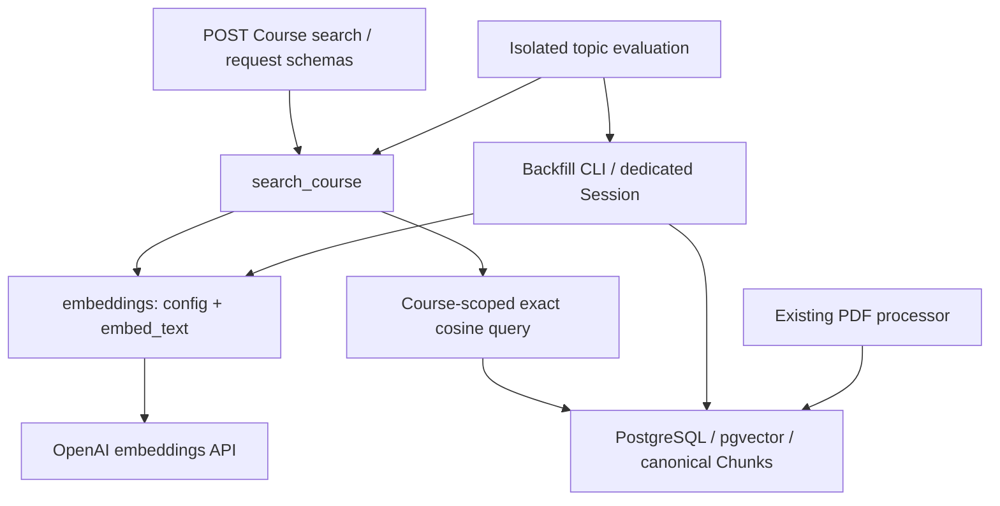

# CourseMate-AI：Retrieval Foundation 修改报告

日期：2026-10-08（Australia/Adelaide）。基线：远端 `ver2` 的
`259609e41da4da7b5d6b9ba0effb22a3ca20c996`。
实现分支：`codex/rag-retrieval-foundation`。
工作区：`/Users/yanzhenli/.codex/worktrees/rag-retrieval-foundation/coursemate-ai`。
没有合并到 main；用户原有未跟踪报告未改动。

状态：功能实现与首轮验证已完成，正在进行最终独立审查。本报告会更新最终审查及测试结果。

## 1. 文件与代码变化

| 文件 | 修改用途 |
| --- | --- |
| `services/api/app/models/chunk.py` | 原有 Chunk 增加向量、配置标识和配对约束；SQLite 仅用 JSON 保存测试数据 |
| `services/api/alembic/versions/c81d4a6b209f_chunk_embeddings.py` | 新增 pgvector 扩展及 Chunk 列的迁移；旧迁移不变 |
| `services/api/app/embeddings.py` | 唯一 provider 边界、不可变配置、配置标识、1536 维校验、安全异常 |
| `services/api/app/embedding_backfill.py` | 独立 Content 事务、重试跳过、强制刷新、CLI |
| `services/api/app/retrieval.py` | `search_course`、课程过滤、Document 去重和 pgvector 余弦排序 |
| `services/api/app/schemas/retrieval.py` | 查询与 top-k 校验、响应模型；复用内部结果 dataclass |
| `services/api/app/routers/courses.py` | 薄 `POST /courses/{course_id}/search` 路由及 HTTP 错误转换 |
| `services/api/app/retrieval_eval.py` | 真实 provider 评估命令，只在临时 PostgreSQL schema 中创建夹具 |
| `evals/retrieval/topics.json` | 并行编程、TCP、会计文本及相关查询；合成方向明确标记为几何测试数据 |
| `services/api/tests/conftest.py` | 共享 SQLite/PostgreSQL fixture、独立 schema 与夹具构建 |
| `services/api/tests/test_embeddings.py` | HTTP 边界、模型配置、维度、数值、秘密不泄漏测试 |
| `services/api/tests/test_embedding_backfill.py` | 两种数据库上的持久化、幂等、回滚、Session 所有权及 CLI 测试 |
| `services/api/tests/test_retrieval_postgres.py` | 真实向量存储/排序、隔离、共享内容、去重、top-k、配置和并发 |
| `services/api/tests/test_retrieval_api.py` | 请求/响应、空课程、404/422/503；成功检索使用真实 pgvector |
| `services/api/tests/test_retrieval_eval.py` | 确定性几何评估、schema 清理及可选真实模型质量评估 |
| `services/api/tests/test_retrieval_migrations.py` | 从旧 head 升级、旧数据保留、类型、扩展、Alembic check 及回退再升级 |
| `services/api/tests/test_processing_postgres.py` | 复用共享 PostgreSQL fixture，保留原有四项处理检查 |
| `services/api/compose.yaml` | PostgreSQL 17 改用含 pgvector 的镜像；保留已有端口和 volume 约定 |
| `services/api/requirements.txt` | 增加固定版本 pgvector 0.4.2、httpx 0.27.2 |
| `services/api/requirements-dev.txt` | httpx 已成为生产依赖，移除重复声明 |
| `services/api/.env.example` | 不含密钥的模型/revision/top-k 配置示例 |
| `services/api/README.md` | 配置、生成、检索、评估与 PostgreSQL 验证命令 |
| `docs/superpowers/specs/2026-10-08-rag-retrieval-foundation-design.md` | 经用户批准的设计与边界 |
| `docs/superpowers/plans/2026-10-08-rag-retrieval-foundation.md` | 经用户批准的实施计划 |
| `docs/RAG_RETRIEVAL_FOUNDATION.md` | 本修改报告 |

未改变 PDF 上传、哈希去重、提取、分块或原子 Content 处理逻辑。

## 2. 数据库与 embedding 配置

新增迁移链：

```text
060be81400d7 → 9a2f1c0e4b7d → c81d4a6b209f (head)
```

新迁移启用 `vector` 扩展，给 `chunks` 增加可空 `embedding vector(1536)`
和 `embedding_config varchar(255)`，两者必须同时为空或同时有值。
旧 Chunk 默认没有 embedding，原文本、页号、索引和层级保持不变。
降级删除新列与约束，保留可能被其他表使用的共享扩展。

默认模型：OpenAI `text-embedding-3-small`，固定 **1536 维**。
支持显式以 1536 维输出使用 `text-embedding-3-large`。
运行配置来自环境变量；没有提交 API key。
向量配置记录为 `openai:{model}:1536:{revision}`，例如
`openai:text-embedding-3-small:1536:v1`。
配置对象在每次生成/查询内固定，避免运行中环境变化造成标签与向量错配。
搜索排除配置不匹配的旧向量；换模型/revision 后可重新生成。
模型别名不是不可变版本：若 provider 在同一别名下发生不兼容变化，需提升 revision。
改维度需要新迁移和完整重嵌入。

## 3. 生成机制与事务所有权

从 `services/api` 运行：

```bash
python -m app.embedding_backfill
python -m app.embedding_backfill --content-id 123
python -m app.embedding_backfill --content-id 123 --force
```

按 ready Content 处理其已有 canonical Chunks；共享文件不会按 Document 重复生成。
有效、同配置向量默认跳过；`--force` 才强制刷新同配置有效向量。
不同配置或无效向量需要重新生成。

`embed_content` 拥有专用 Session 的 commit/rollback；拒绝未提交 ORM 修改及调用方 savepoint。
通过和 PDF processor 相同的 Content no-op UPDATE 获取写锁，锁内重新读取状态和 Chunk。
先准备所有新向量，再原子提交一个 Content。provider、验证、flush、commit 失败均回滚，
保留已有 Chunk 和 embedding；没有失败后删除操作。CLI 遇到失败返回非零退出码，
先前已经提交的其他 Content 不丢失。

`search_course` 使用调用方 Session，仅查询，并通过 `no_autoflush` 避免顺带持久化业务修改。
路由通过原有 `get_db` 创建/关闭请求 Session。未来后台系统应只传 Content ID，并新建 Session。
专用 Session 是调用约定：检查无法识别调用方此前已 flush 的所有无关业务写入。

## 4. Course 隔离与检索流程

```text
query + course_id + top_k
→ 验证 Course / 查询参数
→ 固定 embedding 配置
→ 检查该 Course 是否有 eligible Chunk
→ 生成并验证查询向量
→ Course 范围内 pgvector 余弦排序
→ canonical Chunk 去重后的 top-k + 当前 Course 的 Document 信息
```

SQL 从 `Document.course_id` 过滤，按 Content 选当前 Course 内最小 Document ID，
再关联 Content 和 Chunk。只搜索 ready Content 与同配置非空向量。
Document metadata 来自当前 Course 的代表 Document，不会借用其他 Course 的文件名/ID。
共享 Content 可从所有引用它的 Course 检索；单 Course 多 Document 不会重复返回同一 Chunk。
按 cosine distance 升序、Chunk ID 处理平分，然后 LIMIT。使用精确搜索，未加 ANN 索引。
score 是 `1 - cosine_distance`，不是概率。API 不返回向量、storage_key 或哈希。

请求例子：

```http
POST /courses/123/search
Content-Type: application/json

{"query": "What is parallel speedup?", "top_k": 5}
```

top-k 默认 5，可配置，范围 1–50。query 去除外部空白，不能为空，最多 2000 字符。
不存在 Course 返回 404；无 eligible embedding 返回空结果且不调用 provider；
非法请求返回 422；embedding 失败返回安全的 503。

## 5. 验证结果（独立审查前）

环境：独立 Python 3.12.14 venv；临时 pgvector 容器、独立端口 55437；
PostgreSQL **17.11**、pgvector **0.8.7**。
没有改动用户正在运行的 PostgreSQL 容器/数据库。

测试从 `services/api` 运行，使用本 worktree 根目录的 `.venv`。
`TEST_POSTGRES_URL` 指向独立测试容器。

| 检查 | 结果 |
| --- | --- |
| 修改前 `python -m pytest -q` | 42 passed, 4 skipped, 1 warning |
| 修改后默认 `python -m pytest -q` | 93 passed, 51 skipped, 1 warning |
| 启用 TEST_POSTGRES_URL 的完整 pytest | 143 passed, 1 skipped, 1 warning |
| PostgreSQL retrieval + migration 两文件 | 23 passed |
| `alembic heads` | `c81d4a6b209f (head)` |
| 从 `9a2f1c0e4b7d` 升级 head | 通过；旧 canonical text/page/index/status、Document 关联保留 |
| `alembic current` | `c81d4a6b209f`，迁移测试实际检查 |
| `alembic check` | `No new upgrade operations detected`，迁移测试实际检查 |
| 降级旧 head → 再升级 | 通过；旧数据及共享扩展保留 |
| 确定性三主题评估 | 3/3 预期主题排第一，分数高于无关主题；真实 pgvector、合成向量 |
| 真实 provider 评估 | 未通过运行前提：无 OPENAI_API_KEY；CLI 返回 1 并清理临时 schema |
| `git diff --check` | 通过 |

唯一警告来自已有 Starlette/AnyIO BlockingPortal 弃用接口。
默认跳过项是明确 opt-in 的 PostgreSQL/真实模型检查，不作为已通过报告。
启用 PostgreSQL 后唯一跳过项是需要额外 API key 和 `RUN_LIVE_EMBEDDING_EVAL=1` 的真实模型质量评估。

新测试已先验证失败：存储 5 项；provider 23 项；生成/CLI 34 项和并发 3 项；
检索/API 26 项；评估 4 项。再实现后完整套件转绿。
维度测试初次用裸 SQL 未作用于随机 schema，得到 42P01；改为 SQLAlchemy UPDATE
后验证实际服务器返回 22000 维度错误。没有把 fixture 错误当作产品 bug 修复。

## 6. 维护性审查

初步作者审查如下；最终独立审查结果另行补充。

| 检查项 | 结论 |
| --- | --- |
| 重复逻辑 | PostgreSQL fixture 已共享；结果 dataclass 被 API 复用；provider/向量验证只有一处。Content 锁和 Session guard 与现有 parsing 的少量重复刻意保留，避免更改稳定 ingestion；固定维度在模型/迁移中明确写出，旧迁移不导入可变配置 |
| 不必要抽象 | 只有当前确需的配置、结果数据结构和异常；没有 factory、manager、repository、strategy、插件框架或单实现 ABC |
| 隐藏耦合 | 配置显式捕获；SQL 只在 retrieval；provider 只在 embeddings；SQLite 类型变体不会冒充向量搜索 |
| 函数大小 | 主要操作是单一职责函数，未建立通用服务大类；最长操作是 Content 生成与小型评估 seed/CLI |
| 模块职责 | schema 负责请求/响应，router 转换 HTTP，retrieval 编排/查询，embeddings 调 provider，backfill 管生成事务，eval 负责隔离夹具 |
| Session 所有权 | 请求与检索只读、调用方持有；Content 生成专用 Session 自行提交/回滚；评估只创建临时 schema |
| 状态变更位置 | 原 parsing 成功替换 Chunk；backfill 更新 vector/config 两字段；eval 仅向临时 schema 插入夹具；migration 改 schema；retrieval 无写入 |
| 死代码 | 没有增加未使用的生产接口；CLI main 均有实际命令入口和测试 |
| 假想扩展抽象 | 未添加；将来模型更换局限 embeddings/config，reranker/hybrid 局限 retrieval，RAG 在 retrieval 上层，执行系统调用 backfill |

## 7. 实际依赖图



## 8. 限制与下一步

- 尚无真实模型质量结果，合成向量只证明数据库检索路径。配置 API key 后运行
  `python -m app.retrieval_eval` 或启用 live evaluation 测试。
- 每个 Content 在网络调用期间持有写锁；HTTP 超时有界，但内容内串行生成仍可能较慢。
  当前没有批量 embedding、队列、任务持久化、取消或自动恢复系统。
- 精确扫描适合 foundation；数据规模变大后先评估，再考虑 index，需保持 Course-filter/top-k 语义。
- 成功 PDF 刷新会生成没有向量的新 Chunk，需要再次 backfill；上传尚未自动调度 parsing/embedding。
- 同一 Chunk 保存一套 embedding；更换不兼容配置时旧向量被排除，backfill 完成前该部分不可检索。
- 失败没有持久化错误历史；服务器已提交但客户端未收到确认的网络中断仍需新 Session 读取最终状态再重试。
- 本次没有实现 LLM 生成。推荐下一里程碑是实际课程查询集的 retrieval evaluation，测量
  recall@k、排名和跨课程边界；在质量验证后再做 RAG answer generation。

## 9. 执行裁决

- 使用独立 venv 和 disposable pgvector 数据库：原共享环境在依赖导入中停顿；避免改用户环境。
  错误代价主要是额外 setup 时间。
- 将既有 PostgreSQL fixture 移到 conftest：避免复制 extension/schema 逻辑；原四个 PG 检查已通过。
- 将迁移验证做成持续集成测试而非一次性脚本：可反复证明旧数据保留和升级回退；代价是可选 PG suite 增加几秒。
- API key 不存在，因此提供 provider-backed eval 入口和显式 live skip，不创建伪造的真实模型向量记录。
  错误代价是模型质量仍未评估；不能由本报告推断可开始答案生成。
