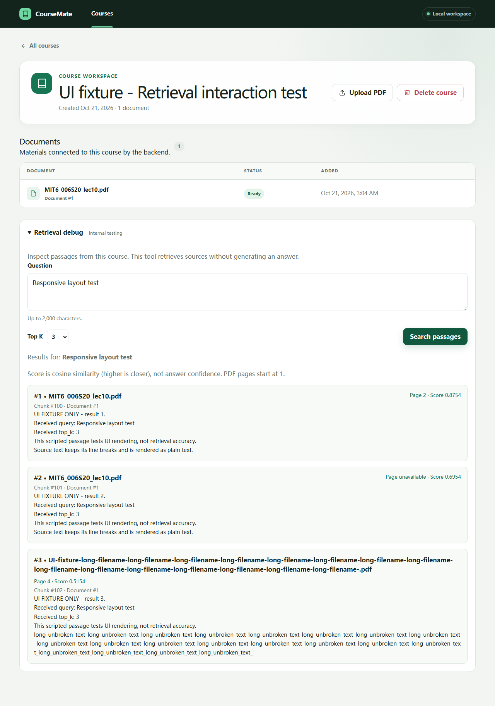
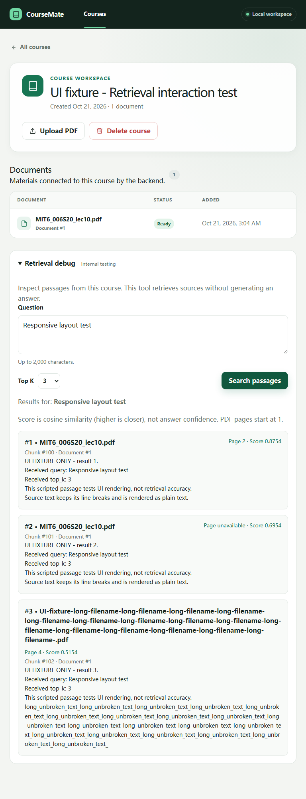
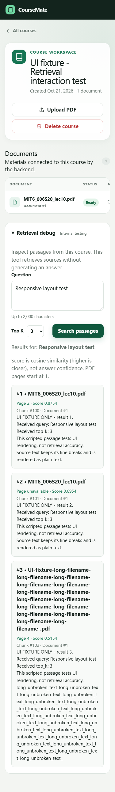

# Retrieval 页面交互实测

日期：2026-10-21。基线：`c33de9c`。

原先未完成的浏览器交互验证已经补齐。独立 Chromium headless shell
156.0.8078.4 / Playwright 1.64.1 实际加载 Next.js 生产构建并执行点击、输入、
页面跳转、取消与断网操作。**15 项通过，0 项失败，0 项跳过，0 次重试，
运行时间约 54.4 秒。**

## 测试覆盖

| 操作 | 验证结果 |
| --- | --- |
| 首页进入 Course，键盘展开/收起调试面板 | 通过 |
| 空白问题 | 显示校验提示，未发送 search 请求 |
| 提交问题 | 去除首尾空白，发送 POST、正确 course ID、query 与 top_k |
| 加载状态 | 搜索按钮、输入框和 Top K 暂时禁用，响应后恢复 |
| 正常结果 | 顺序、完整文本、换行、PDF 名、chunk/document ID、页码和 score 正确 |
| 特殊结果 | null 页码显示 unavailable；负 cosine score 正常显示 |
| 改变 Top K | 请求值更新，旧结果被新结果替换 |
| 2000 字符上限 | 页面输入实际受限 |
| 空候选 | 清除旧结果并提示检查解析和 embedding |
| HTTP 404 / 422 / 503 | 展示状态和详情，后续成功查询可恢复 |
| 网络中断后重试 | 展示网络错误，连接恢复后可重新查询 |
| 搜索中离开 Course | 中止请求；进入另一个 Course 时状态和结果重新初始化 |
| passage 中的 HTML 字符串 | 作为文本显示，不产生 HTML 元素 |
| 375 / 768 / 1280px | 长文件名与无空格长文本均换行，页面无横向溢出 |

完整逐项状态与耗时见 [机器可读结果](assets/retrieval-ui/results-2026-10-21.json)。
没有发现需要修改的 retrieval 面板逻辑或样式缺陷；本次修正的是缺失的浏览器验收、
可复现测试环境及过期的“未完成”说明。

## 实测边界

前端运行实际 production build；API 运行现有 FastAPI 路由、响应 schema 和 CORS，
数据库为独立内存 SQLite。测试进程内将 search 实现替换成明确标记的脚本化结果，
以稳定覆盖结果、空候选和错误分支；没有修改生产 search、embedding 或 pgvector。
网络失败用浏览器请求中断模拟。截图中的 Course 和 passage 均标记为 UI fixture。

因此，本报告确认的是“真实浏览器中的页面和 API 契约交互”，
不是“真实 embedding + PostgreSQL 排序”的端到端质量测量。
真实课程问题集和所有来源标签已核对。队友随后补充了本地 BGE 模型与 pgvector 的测量，
见 [真实课程报告第 5 节](REAL_COURSE_RETRIEVAL.md#5-首次实测本地免费-embedding2026-10-21)；
本报告中的脚本化 UI 结果不参与该测量。生产 OpenAI 模型仍需额度恢复后另行验证。

## 复现

需要 Node.js 20.9+、已安装 API requirements 的 Python（推荐使用
`services/api/.venv`）。测试不需要 OpenAI key 或 PostgreSQL。
先停止使用 3000 / 8000 端口的其他本地服务；配置会拒绝复用未知服务。

从 `apps/web` 执行：

```bash
npm ci
npx playwright install chromium --only-shell
npm run test:e2e
```

`pretest:e2e` 自动运行已验证可用的 Webpack production build，随后测试配置启动
临时 API 与前端，测试结束后自动停止。测试框架使用独立临时浏览器配置，
不读取用户 Chrome 的标签、登录信息或浏览记录。
若 Python 环境不在默认位置，设置 `COURSEMATE_TEST_PYTHON` 为已安装依赖的解释器路径。

测试代码：

- [Playwright 配置](../apps/web/playwright.config.mjs)
- [交互用例](../apps/web/e2e/retrieval-debug.spec.mjs)
- [内存 API 测试服务](../services/api/tests/retrieval_ui_server.py)

完整 HTML 报告位于本地 `apps/web/playwright-report/index.html`；
原始 JSON、截图和失败 trace 位于 `apps/web/test-results/`。这些临时目录均被忽略。
下面三份截图与摘要保存在仓库中，便于审查。

## 截图

桌面 1280px：



平板 768px：



手机 375px：


