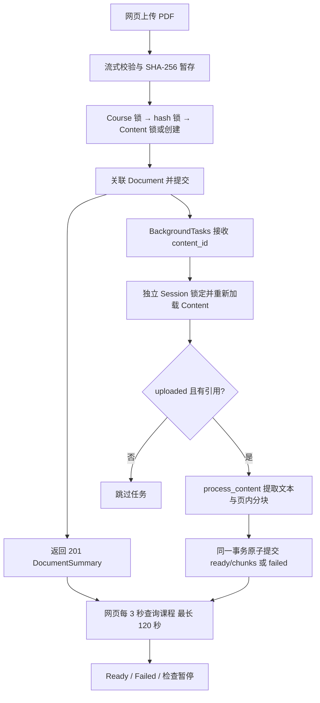
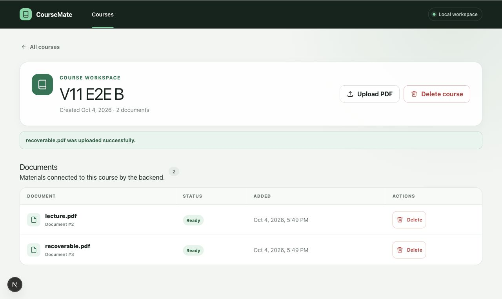
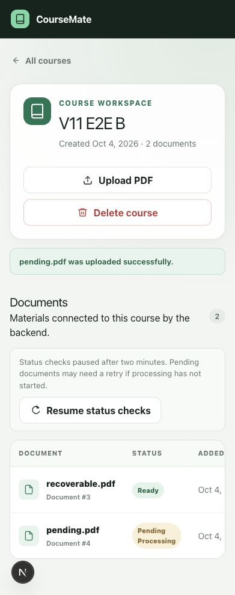

# CourseMate-AI V1.1 项目工程报告

日期：2026-10-04。基线：最新远程 `ver2`，`259609e41da4da7b5d6b9ba0effb22a3ca20c996`。
实施分支：`feature/v1.1-document-processing`，独立工作目录；没有合并到 main，也没有推送本次改动。

交付目录：`/Users/yanzhenli/.codex/workspaces/coursemate-ver2-processing-reliability`。主工作目录的 Git status/cat-file 多次超时，因此新分支保留在此持久独立 clone，没有声称已成功注册到主工作目录。主工作目录文件未切换；交付 clone 的工作树已干净。测试 API、前端服务和专用 PostgreSQL 容器验证后已停止，原 8000 服务与开发数据库未修改。

## 结论与交付范围

**正常用户现在可以通过网页上传、自动处理、观察状态、重试、删除课程 PDF，无需手动调用 Python 处理函数。** 真实两页 PDF、共享复用、注入解析失败后的界面重试，以及共享关联/最终关联删除，均已在浏览器连接真实 PostgreSQL 时验证。

这是本地文档 ingestion 的 V1.1 里程碑。尚未实现 embeddings、检索、RAG、LLM 回答、OCR、身份验证或分布式任务队列；不能把当前项目描述为已完成的 AI 问答系统。

## 基线与变化

基线具备课程 CRUD、上传、SHA-256 去重、共享 Document/Content、pypdf 提取、页内分块、原子块替换和处理串行化；上传与解析之间未连通，网页无法持续观察、重试或删除单个文档。

| 问题 | 根因 | 设计与实现 | 验证 |
| --- | --- | --- | --- |
| 上传后没有解析 | 上传事务没有调度处理 | 提交 Document/Content 后调度 ID；后台独立 Session 重新加载、加锁、判断 uploaded | 提交可见性、独立 Session、201 快照与实际 ready/chunks |
| 失败不能从界面恢复 | 缺少 scoped retry API | failed→uploaded 先提交，再调度；ready/processing 原样返回 | 状态表、错误课程 404、真实 UI 失败恢复、PG 等锁重试 |
| 状态需要刷新页面 | 缺少轮询生命周期 | 单循环、3 秒间隔、120 秒硬上限、异常独立显示、卸载 abort、动作后重启 | 6 项 Node 测试、真实 Ready/Failed/网络错误与两分钟暂停 |
| 文档不能单独删除 | 只有课程级删除 | 删除关联，锁定并检查剩余引用；课程删除采用同一策略 | 两课程共享保留、最后引用清理、解析与删除并发 |
| 最后引用文件清理可能与 DB 失败失配 | 数据库和文件系统没有共同事务 | 提交 pending_cleanup 意图后才 unlink；保留可重试 tombstone | unlink 故障、清理提交故障、补做清理 |
| 同课程重复关联没有最终 DB 保障 | 只有应用层查询 | 新 unique(course_id, content_id) 约束与迁移；IntegrityError→409 | 真 PostgreSQL 约束与历史重复迁移拒绝 |
| 失败上传可能误删另一成功请求接管的文件 | rollback 释放锁后，文件所有权信息已过时 | hash 事务锁；失败后重新加锁检查持久 Content，再决定是否删文件 | PG 两请求失败/接管回归测试 |

## 完整架构与事务边界

上传响应使用提交前已 flush 的 DocumentSummary 快照；只有提交成功才调度。上传成功不依赖后台处理成功。后台只收到整数 ID，不接收请求 Session 或 ORM 对象，并保证 Session 关闭；重复任务在 Content 锁下读取权威状态，首个任务完成后，其余任务跳过。历史 failed 不自动循环，ready 共享复用不自动刷新。

处理核心保留原有安全边界：Content 写锁一直持有到外层事务结束；savepoint 中准备和替换块；初次失败为 failed；已 ready 的显式核心刷新失败保留 ready 与原块；数据库提交失败仅 rollback，不在释放锁后补写可能覆盖另一 worker 的状态。本次没有新增公开 refresh API，网页 Retry 不刷新 ready。

新尝试中的 processing 是事务内状态。其他读者通常仍看到 uploaded，直到 ready/failed 提交；不为了进度展示提前提交 processing。解析期间占用 DB 连接、持有行锁，重试/删除可能等待它。

## 状态机和 API

| 已提交状态 | 自动任务 | Retry API | 删除最后引用 |
| --- | --- | --- | --- |
| uploaded | 有引用时可尝试 | 202 uploaded；提交后调度 | 提交 pending_cleanup |
| failed | 跳过 | failed→uploaded；202 后调度 | 同上 |
| ready | 跳过；跨课程复用 | 200 原样返回，不重解析 | 同上 |
| processing（历史） | 跳过，不自动重置 | 200 原样返回，不重复调度 | 等锁后判断引用 |
| pending_cleanup | 跳过；上传复用拒绝 409 | 409 | 只允许幂等清理 |

新处理尝试：`uploaded → [事务内 processing] → ready / failed`。显式重试：`failed → committed uploaded → attempt`。ready 的核心刷新失败保留 ready，不属于普通网页 Retry。

- `POST /courses/{course_id}/documents`：201，最大 10 MiB，PDF 扩展名/MIME/header 校验；重复关联 409。
- `POST /courses/{course_id}/documents/{document_id}/retry`：202 eligible；200 ready/processing；404 错误关联；409 pending_cleanup。
- `DELETE /courses/{course_id}/documents/{document_id}`：204，仅删除 scoped Document。
- 返回字段仍为 `id/name/created_at/status`，不会泄露内部文件路径。

## 共享内容与文件一致性

多个 Document 可指向同一 Content。只要任何课程仍引用，该 Content、PDF 和 canonical chunks 就保留。删除课程也只清理刚失去最后引用的 Content，不改变其他课程的数据。

清理采用提交意图协议：

1. 事务内锁住 Course/Content，删除关联并 flush，检查引用。
2. 没有引用时标记 pending_cleanup，提交关联删除和状态。
3. 提交之后调度独立 cleanup Session；先 hash 锁，再 Content 锁，再确认状态与零引用。
4. unlink（允许文件已不存在），删除 Content/级联 chunks，提交。

这**不是**数据库和文件系统的一次 ACID 事务。unlink 失败保留 pending row、hash、storage metadata 和 chunks。unlink 成功后最终 DB 提交失败可能保留“文件已不存在”的 tombstone；它没有活跃 Document 引用，后续 missing_ok 清理可完成。关联删除提交失败时根本不会调度文件删除。

hash 事务锁协调新上传、清理及失败上传文件处置。PostgreSQL 使用由 SHA 前 64 位派生的 transaction advisory lock（碰撞最多增加串行等待）；SQLite 使用数据库写锁。上传遇到 pending_cleanup 返回 409，不能在清理期间把新关联接上。并发成功请求接管失败上传创建的 hash 文件后，失败请求重新查到持久 Content，会保留该文件。

漏跑清理任务可从 `services/api` 执行 `python -m app.cleanup`。CLI 只重试已记录的 pending_cleanup；它不是任意孤立文件扫描器，也不是持久任务队列。失败日志仍需操作员检查，CLI 目前不输出每项成功/失败汇总或非零失败退出码。

## 迁移

新增 revision `c3a11d0c2026`，承接 `9a2f1c0e4b7d`，不改历史 revision。升级前检查历史重复 course/content 关联；存在重复时拒绝并要求备份、明确协调 Document 行后重试，不静默删用户数据。

真实迁移测试在独立 PostgreSQL schema 中：旧 head→插入重复→升级拒绝且数据/version 保留→明确删除测试重复→head 成功并确认唯一约束。真实浏览器库从空 schema 完成整个 revision 链。

## 验证结果

环境：Python 3.12、PostgreSQL 17 隔离测试容器、Node 22.14.0/npm 10.9.2、Next 16.3.0/React 19.2.8。测试使用唯一临时 schema；浏览器使用专用 `v11_e2e` schema、临时 storage 与 8011 API，不修改开发者数据库/8000 服务。

| 检查 | 基线 | 最终结果 |
| --- | --- | --- |
| 默认后端 pytest | 42 passed / 4 skipped | **57 passed / 10 skipped** |
| 启用 TEST_POSTGRES_URL 的完整后端套件 | 46 passed | **67 passed** |
| PostgreSQL 生命周期子集 | — | **5 passed**（包含 retry 锁等待、失败文件接管） |
| 真实迁移检查 | — | **1 passed**（也包含在 67 中） |
| 前端 lint | passed | **passed** |
| 前端 build + TypeScript | passed | **passed** |
| 前端 Node 轮询生命周期测试 | — | **6 passed** |
| 独立代码审查 | — | 无已确认功能缺陷；指出的 PG retry 测试缺口已补充 |

后端保留 1 条依赖警告：Starlette 使用已弃用 AnyIO BlockingPortal alias。Node 测试有 Type Stripping、MockTimers 实验性和 MODULE_TYPELESS_PACKAGE_JSON 警告；没有新增测试框架，没有为消除警告修改应用模块体系。普通前端运行/构建不需要 Node 类型剥离，新增 `npm test` 需要支持该选项的 Node。

复现：`services/api` 中 `python -m pytest -q`；设置独立 `TEST_POSTGRES_URL` 后同一命令。`apps/web` 中 `npm run lint`、`npm test`、`npm run build`。

### 浏览器端到端记录

全部通过原有网页操作和真实 PDF file chooser；之后查询 PostgreSQL 与临时文件目录，不以仅调用 API 代替 UI 验证。

| 场景 | 实际观察与数据证据 |
| --- | --- |
| A 正常上传 | 两页 lecture.pdf 在课程 A 中自动 Ready；Content 1；2 个块，page_number 1/2、chunk_index 0/1，提取文本与原文一致 |
| B 跨课程共享 | 同 PDF 上传课程 B 直接 Ready；两个 Document 指向 Content 1；提取尝试日志仍只有一次，块未增加 |
| C 失败与修复 | 临时 E2E wrapper 注入 RuntimeError，上传仍 201，Document 3 保留并自动显示 Failed；去除故障后界面 Retry→Pending→Ready；Content 2 有 1 块 |
| D 删除一个共享关联 | 从课程 A 确认删除 Document 1；A 空，B Document 2 仍 Ready；Content 1 的 2 块和 hash 文件仍存在 |
| E 删除最后共享关联 | 从 B 删除 Document 2；Content 1、两个块和对应文件消失；独立 Content 2 / Document 3 /文件保留 |
| 补充轮询故障 | 仅测试 wrapper 暂停调度 pending.pdf，UI Pending；停测试 API 后显示状态检查错误，文档仍在；恢复 API 后 Resume status checks 成功 |

失败注入与跳过调度仅在 `/tmp` 的 E2E launcher 中，不进入产品代码。轮询控制器还通过假时钟验证无重叠、挂起请求截止 abort、普通响应不重置 deadline、重启 deadline、终态停止、卸载取消。真实两分钟暂停已观察到 “Status checks paused after two minutes”；随后点击 Retry，pending.pdf 自动变为 Ready，证明轮询 deadline 不会被普通响应不断续期，丢失任务可以显式恢复。

## 已知限制与下一步

- BackgroundTasks 不持久；崩溃/重启可丢失已调度工作，没有持久队列或启动补跑。uploaded/failed 可界面重试，pending_cleanup 可 CLI 补做。
- 历史 committed processing 不自动恢复；需操作员确认没有存活处理者后调查/恢复，避免盲目抢占。
- 解析占用连接并持有 DB 锁；对本地小文件够用，长任务/大量并发需要将来独立设计 worker、恢复协议、超时和资源限制。
- 只支持文本 PDF；扫描件没有 OCR，提取不到 meaningful text 会 failed。
- 本地文件系统与 DB 不共同提交；记录型清理能恢复，但进程硬崩溃可能留下 staging/未记录孤立 hash 文件，需要另行保守巡检策略；当前 CLI 不扫描此类文件。
- 没有身份验证、embedding、检索、AI 回答；尚不是公开多用户生产部署。
- 当前后台错误日志保存诊断，API/UI 尚不提供持久化结构化失败原因；UI 展示 Failed 和操作错误。

V1.1 对正常本地课程 PDF ingestion 已可用，证据是上述真实网页流程和事务/并发回归。下一里程碑只建议：**Chunk → Embedding → course-scoped similarity search → retrieval evaluation**，先定义小规模检索 benchmark、引用元数据与 embedding 版本策略，再评估 top-k 命中质量；暂不开始 AI 答案生成。

### 界面证据

失败重试后两份材料均为 Ready：

真实两分钟轮询暂停，文档保留 Pending 和 Retry：

最后补充：暂存文件处置异常不应把已经提交的上传变成 HTTP 错误。先以 OSError 注入测试确认失败，再把该处置改为记录日志，保留暂存文件供保守巡检；最后完整 PostgreSQL 套件为 67 项通过。
