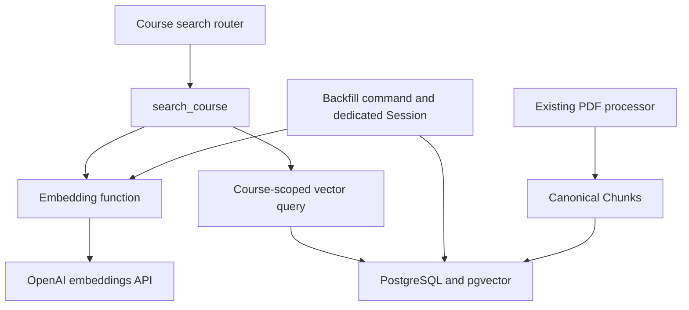

# CourseMate-AI retrieval foundation

Status: design approved by the user on 2026-10-08. No application implementation yet.
Date: 2026-10-08 (Australia/Adelaide).

## Intent and inspected baseline

Given a Course ID and natural-language query, retrieve ranked existing canonical
Chunks reachable from that Course. Preserve ingestion and atomic Content
processing. No answer generation, chat, prompting, generated citations, agents,
OCR, authentication, task queue, separate vector database, or RAG framework.

The remote `ver2` tip was verified with `git ls-remote`: commit
`259609e41da4da7b5d6b9ba0effb22a3ca20c996`. This commit is available locally on
`fix/ver2-processing-reliability`; local `ver2` and `origin/ver2` initially lagged.
The current checkout is `main`, with an existing untracked
`docs/PROJECT_REPORT_VER2.md`, which must be preserved. A normal fetch failed
because of malformed local remote refs; do not delete those refs as part of this
feature. The user approved an isolated worktree, now created at
`/Users/yanzhenli/.codex/worktrees/rag-retrieval-foundation/coursemate-ai`, on branch
`codex/rag-retrieval-foundation` based on the verified commit. Do not merge to `main`.

Inspected: all four models, both existing Alembic revisions and environment,
database/session configuration, upload routes, parsing/chunking and processing
transaction boundaries, API schemas, SQLite tests, PostgreSQL isolation tests,
Compose configuration, dependencies, and the processing reliability report.
The current migration head is `9a2f1c0e4b7d` by revision-chain inspection;
executed Alembic and test results must be recorded during implementation.

## Storage decision

Add two nullable fields to `Chunk`: `embedding` and `embedding_config`.
Use PostgreSQL `vector(1536)` through the pgvector SQLAlchemy type. A paired-null
constraint ensures that vector and configuration are either both present or
both absent. Do not duplicate text, introduce another hierarchy, or modify old
migrations. A new revision following `9a2f1c0e4b7d` enables `vector` with
`CREATE EXTENSION IF NOT EXISTS` and adds the fields and constraint.
Downgrade removes the fields/constraint and leaves the shared extension installed.

Use `pgvector/pgvector:pg17` for the development PostgreSQL image, retaining the
existing major version and storage conventions. Verify in a separate disposable
database; do not migrate a user's existing database for test verification.
Existing SQLite tests can use a JSON type variant for vector persistence;
similarity ranking remains PostgreSQL-only and must be tested there.

Direct Chunk fields are preferred over a separate one-to-one table, which adds
joins and lifecycle machinery without solving another current requirement.
A multiple-model embedding table is deferred; this milestone stores one active
embedding configuration per canonical Chunk.

## Embedding boundary and configuration identity

`app/embeddings.py` owns provider calls, configuration, vector validation, and
the explicit function `embed_text(text: str) -> list[float]`.
The initial provider is OpenAI, with `text-embedding-3-small` and exactly 1536
dimensions. API key and model selection come from environment configuration;
the dimension is a schema constant, not an arbitrary runtime setting.
Validate supported model configuration and request 1536 dimensions explicitly.
Reject empty input, wrong-length vectors, non-finite values, and zero vectors.
Use finite HTTP timeouts and safe generic errors; never log provider payloads,
authorization headers, keys, or raw provider exceptions that could expose secrets.

Persist a canonical configuration identifier containing provider, model,
dimension, and input/embedding revision, e.g.
`openai:text-embedding-3-small:1536:v1`. The revision is environment-configurable
and documented; operators bump it for incompatible changes that retain a model
alias. Model aliases are not immutable provider snapshots. Search only vectors
whose configuration identifier equals the query embedding's identifier.
Load one immutable configuration per operation so changing settings cannot
label vectors with a different configuration than the one used to generate them.

A compatible model replacement at 1536 dimensions is configured and explicitly
re-embedded. A different dimension requires a new migration and complete
re-embedding. Existing mismatched vectors are excluded from search and replaced
by a backfill for the new configuration. Never compare incompatible vectors.

## Generation and mutation ownership

Use `app/embedding_backfill.py` for an operator-invoked command:
`python -m app.embedding_backfill [--content-id ID] [--force]`.
It consumes existing ready Content and canonical Chunks and does not import
PDF parsing or change upload behavior. Process distinct Content IDs so shared
documents do not duplicate work. Report generated/skipped counts and failures;
return a nonzero exit status if any Content fails.

The generation function owns its commit/rollback and requires a dedicated clean
Session. Acquire the same Content write lock used by processing, refresh state
under that lock, and verify `ready` before reading chunks. This serializes
generation with PDF refreshes and competing generation attempts. Skip vectors
already valid for the current configuration unless `--force` is present.
Validate generated vectors before writing. Commit vector/configuration updates
atomically for one Content; on provider, validation, flush, or commit failure,
roll back and preserve all previously committed Chunk text, metadata, vectors,
and Content status. Successfully committed Contents survive later failures.

Holding the Content lock during provider calls is a deliberate simple baseline:
it prevents stale embeddings and duplicate concurrent generation, but delays
processing of that Content. Bound HTTP duration and document the tradeoff.
The generation function is usable from a future execution system with a new
Session; do not implement that system now.

Mutation locations: existing PDF processing replaces canonical Chunk rows;
generation updates only embedding/configuration fields; the new migration
changes schema. Retrieval performs no writes. A successful PDF refresh creates
new chunks without embeddings; rerun the backfill. Failed PDF refreshes preserve
existing vectors through the existing transaction protocol.

## Retrieval and API boundaries

`app/retrieval.py` exposes
`search_course(db: Session, course_id: int, query: str, top_k: int) -> list[RetrievalResult]`.
It receives the existing Session convention explicitly, checks Course existence,
embeds the query, and calls a small Course-scoped query function in the same
module. That function owns SQLAlchemy/pgvector ranking expressions. Keeping
orchestration and SQL in two functions within one focused module is sufficient;
no repository framework or strategy class is warranted.

Reachability is enforced in SQL through Document.course_id, Document.content_id,
Content.id, and Chunk.content_id. Filter ready Content, non-null embeddings,
and the matching configuration before ranking. Return each canonical Chunk once;
if multiple documents in the same Course reference it, choose the lowest
document ID deterministically. Document metadata must come from that Course.
Shared Content is independently reachable from every referencing Course.

Rank by exact cosine distance ascending; score is `1 - cosine_distance` and is
not a probability. Break equal-distance ties by Chunk ID. Apply `top_k` after
Course filtering and canonical-result deduplication. Start without an approximate
vector index to preserve exact scoped ranking; benchmark before adding one.

`app/schemas/retrieval.py` contains validated request and result/response models.
`POST /courses/{course_id}/search` is a thin handler in the existing Course
router. Default top-k is 5, configurable through environment; enforce a positive
value and a hard maximum of 50. Reject blank queries, trim outer whitespace,
and cap query length at 2000 characters. Return 422 for invalid payloads, 404
for a missing Course, a safe 503 for embedding provider/configuration failures,
and `{"results": []}` when no eligible embeddings exist.
Results expose chunk ID, text, page number, Course-local document ID/name, and
score. Do not expose vectors, content hashes, storage keys, or provider details.

Retrieval uses a caller-owned read-only Session: it does not commit, roll back,
close, or mutate it. The router obtains/closes that Session through `get_db`.
Lower-level modules do not import routers or FastAPI. A future reranker or
lexical candidate source can be added to retrieval orchestration; future RAG
generation calls retrieval and does not become its dependency.

## Tests and evaluation

Add focused provider/configuration and API validation tests, and generation
tests for persistence, retry no-op, explicit force, mismatched configuration,
invalid output, partial provider failure, and existing-data preservation.
Test dedicated-session ownership rather than accidentally committing unrelated
pending objects. Preserve the complete existing backend suite.

Use real PostgreSQL with pgvector for persistence, dimension enforcement, cosine
ranking, top-k, missing Course, cross-Course isolation (including a closer foreign
chunk), shared Content, duplicate Course-local document references, absent
embeddings, non-ready Content, model mismatch, and processing/generation
serialization. No mocked SQL or SQLite similarity substitute.

Create a deterministic small parallel-programming/TCP/accounting fixture with
explicit query expectations. Fixed synthetic vectors may prove database ordering
but cannot establish model quality. Prefer recorded real vectors from the chosen
model for a reproducible offline semantic check, with provenance and capture
command. If credentials are unavailable, report this limitation explicitly and
provide a runnable provider-backed evaluation; do not label synthetic vectors a
validated embedding-quality result.

In an isolated disposable PostgreSQL database, migrate to the existing head,
seed representative pre-retrieval rows, then upgrade through the new revision.
Verify preservation, vector types, extension presence, and migration downgrade /
re-upgrade. Record exact `alembic heads`, backend pytest results, PostgreSQL
retrieval results, and evaluation outcomes. Explicitly identify skips/failures.

## Maintainability review and delivery

Before completion review and report: duplicated logic, unnecessary abstractions,
hidden coupling, oversized functions, unclear module responsibilities,
transaction/session ownership, every Chunk/embedding mutation location, dead
code, and abstractions serving only hypothetical future use. Remove complexity
found during that review and rerun the checks affected by edits.

Do not add factories, strategy hierarchies, generic repositories, plugin systems,
manager classes, another dependency injection system, one-implementation abstract
base classes, or utils/helpers dumping grounds. Dependency direction stays
router -> retrieval -> embedding provider/database query. PDF processing does
not depend on retrieval. Configuration identity/validation lives in embeddings;
do not copy it into backfill, routers, or models.

Final report must cover changed files; migration/database changes; model and
dimension; generation mechanism; Course isolation; query flow; tests; exact
verification; limitations; maintainability findings; the implemented dependency
diagram; and the next milestone: broader retrieval evaluation before RAG answers.

## Sources

- [OpenAI embeddings guide](https://developers.openai.com/api/docs/guides/embeddings):
  model dimensions and embedding requests.
- [pgvector](https://github.com/pgvector/pgvector): extension, exact search,
  cosine distance, PostgreSQL images.
- [pgvector Python](https://github.com/pgvector/pgvector-python): SQLAlchemy vector
  storage and cosine distance expressions.
